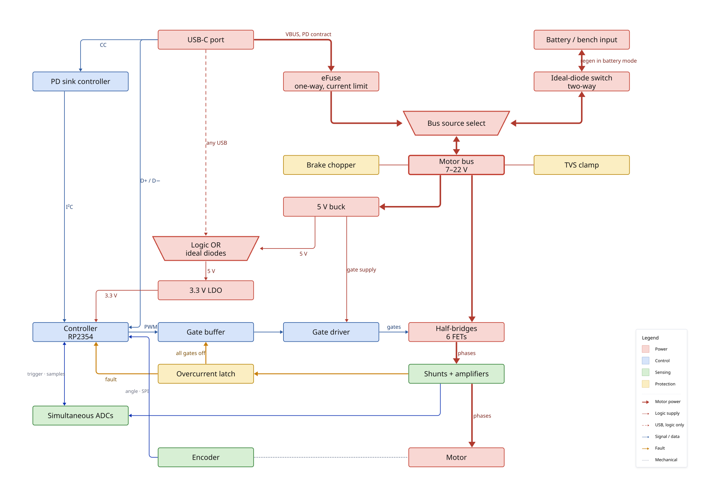

# d2-gridlayout

Grid placement for [D2](https://d2lang.com) diagrams, driven by rules like
"power flows down, signals flow right". It places each block in a grid cell,
writes the positions back into your `.d2` file as `top`/`left`, and leaves the
line routing to D2's TALA layout engine, which keeps locked positions and draws
right-angle lines.

ELK and dagre lay a diagram out along one axis only. That's fine for a
pipeline, but a system diagram often wants two: power top to bottom, control
left to right. This tool is a small, scrappy answer to that.



## Setup

```sh
pip install -e ".[dev]"   # editable install: the Node helper is found via the repo
npm install               # D2's JS compiler, used to read .d2 files
```

Rendering the result needs the D2 CLI **v0.9 or later**, which bundles TALA.

## Use

```sh
d2-gridlayout layout diagram.d2 --rules rules.toml   # writes positions into diagram.d2
d2 diagram.d2 diagram.svg                            # TALA is set by the generated block
d2-gridlayout route diagram.svg --rules rules.toml   # redraw the lines in [routes]
d2-gridlayout score diagram.d2 --rules rules.toml    # report on the current layout
```

Useful `layout` options:

- `--seeds 0,1,2,3`: annealing restarts; the best result wins.
- `--iterations N`: annealing steps per seed.
- `--refine`: start from the positions already in the file.
- `--brute a,b,c`: after annealing, place these few nodes exhaustively.
- `-o out.d2`: write elsewhere instead of overwriting.

The tool appends one clearly marked block of `top`/`left` settings to the end
of the file and replaces it on later runs. Everything else in the file is left
untouched.

## Rules

```toml
[grid]
rows = 11
cols = 5
col_px = 420     # column pitch in the rendered diagram
row_px = 140

[directions]     # edge class -> down | right | free
feedback = "free"
pwr = "down"
sig = "right"
default = "free" # edges with none of the classes above

[pins]           # node id -> [row, col]
usb = [0, 1]

[options]
ignore = ["_*"]  # node id globs to leave out
```

An edge's kind is the **first** of its D2 classes that appears in
`[directions]`. A layout-only tag therefore overrides the styling class:
`a -> b {class: [feedback; sig]}` is styled as a signal but placed freely.
Define the tag as an empty class (`feedback: {}`) so D2 accepts it.

Edges are read in arrow direction, so `a <- b` counts as running from b to a.
Containers aren't placed (only the blocks inside them), and edges to a
container are skipped with a warning. Blocks inside a container get positions
relative to it, as TALA expects, and the container is placed around them.
TALA routes lines between containers poorly; boxes (below) avoid that.

```toml
[boxes]            # background box -> node id globs it encloses
board = ["mcu", "r_*"]

[options]
box_padding = 40   # px between a box and its blocks
box_label_px = 40  # extra px above for the box label
```

A box is a plain top-level shape drawn behind its blocks, which is an
alternative to a container when you only want a visual grouping. A box can
also enclose other boxes. The tool writes its position and size. Declare
boxes first in the `.d2` file so they draw underneath.

## Hand routes

TALA keeps locked positions but picks its own connection points along each
side, so it often bends a line that could run straight. `route` rewrites the
listed lines in the rendered SVG, keeping D2's colours, arrowheads and labels:

```toml
[routes]           # edge -> exit side, entry side
"a -> b" = {exit = "right", enter = "left"}
"conn -> mux" = {exit = "left", enter = "top", gap = 60, offset = -60}
```

Parallel sides give a straight line where the blocks overlap, or a Z.
Perpendicular sides give an L whose last leg is `gap` px long. `offset` moves
the line along the entry side, so that two lines between the same blocks stay
apart. Keys are D2 edge ids; add `[n]` for the nth edge between a pair. D2
numbers `<->` edges across both orders, and the error for a missing edge lists
the ids present.

## How it works

Each candidate layout is scored on:

- **Direction:** does each edge run the way its kind prefers? A straight edge
  pointing the right way costs nothing, a diagonal that still heads the right
  way costs a little, and anything pointing backwards costs a lot.
- **Length.**
- **Lines through blocks.**
- **Crossings.**
- **Span:** how many rows and columns the layout uses.

Simulated annealing searches placements, keeping pinned blocks fixed, and
`--brute` finishes off a handful of nodes exhaustively. Blocks are centred in
their cells, so blocks of different sizes still line up.

## Limits and lessons

- **Pin the blocks that carry the structure.** Annealing from scratch tends to
  find layouts that score well but read badly. What worked best on the example
  was to hand-place the main power column, the control row and the inputs, then
  let the solver fill in the rest.
- **The score is a proxy.** It measures straight lines between cell centres,
  but TALA routes around blocks, so the real crossings in the render can differ.
  Always look at the output.
- **Feedback paths should be `free`.** Otherwise the solver pushes them the
  "forward" way and the layout fights itself.
- **It's slow-ish.** Pure Python, about 1 ms per evaluation on a 20-node diagram.
  Fine for diagrams, not for big graphs.

## Development

```sh
pytest
mypy          # strict
```
